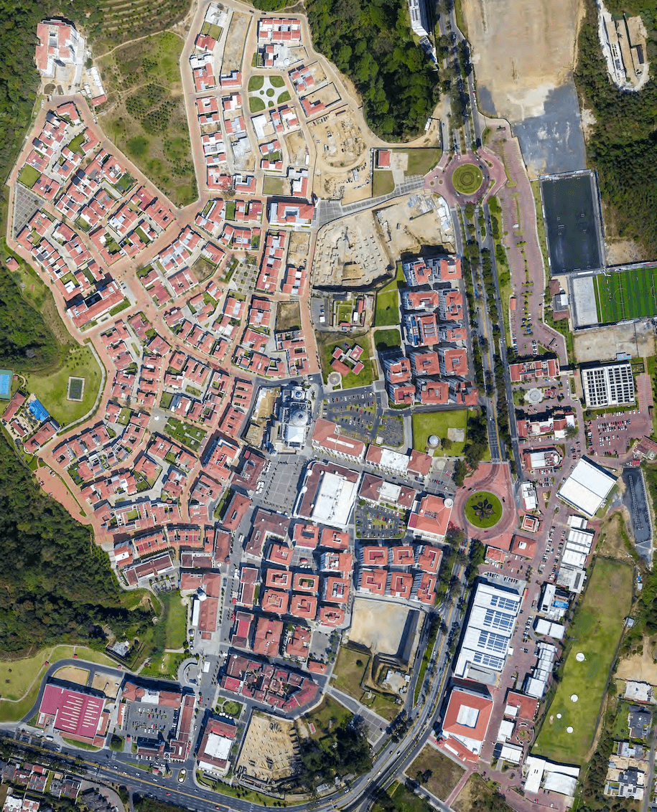
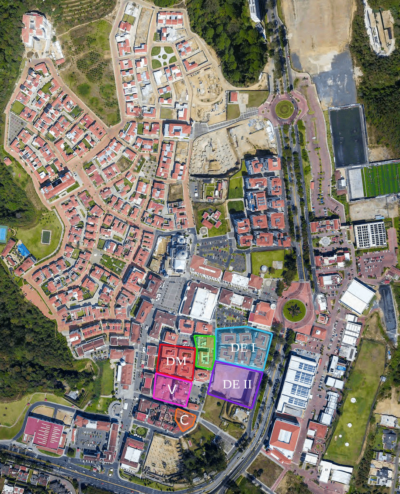
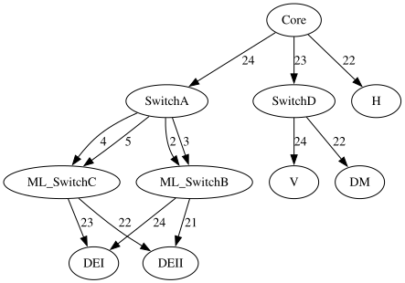
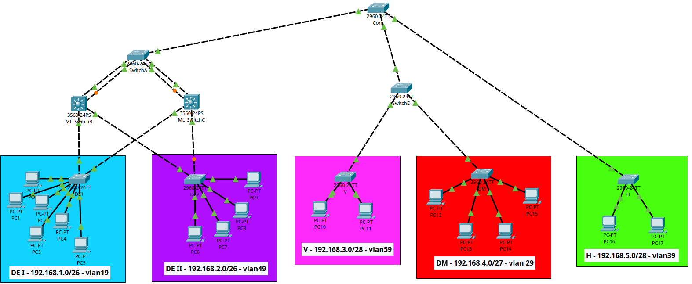
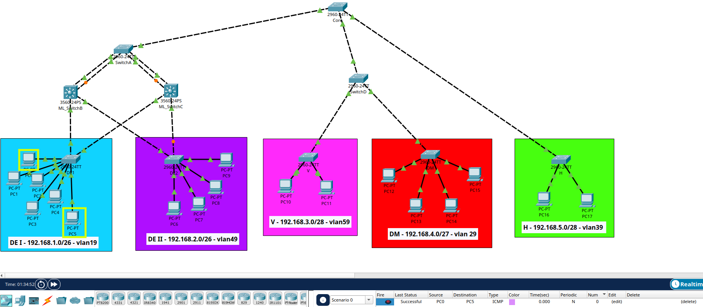
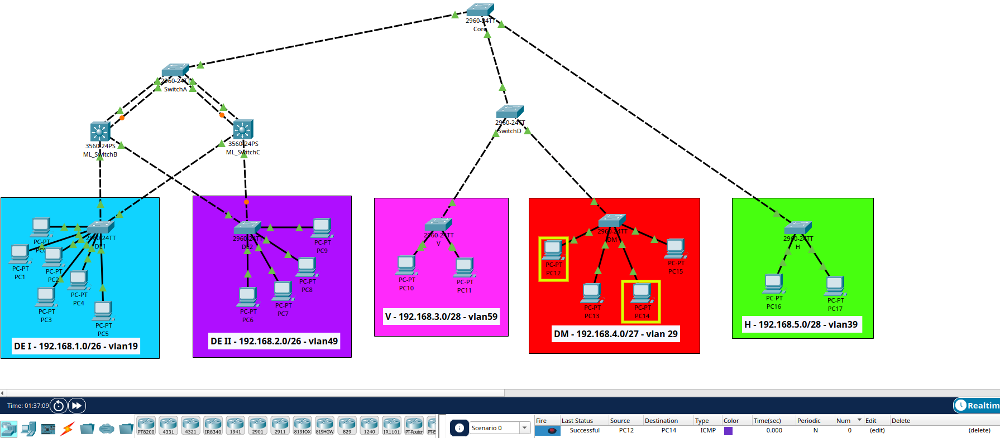
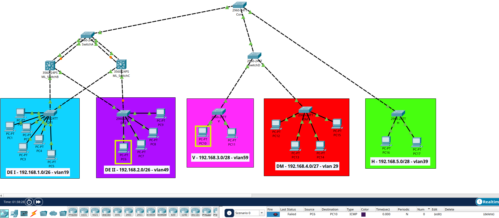

# Red de la ciudad comercial Cayalá

El presente manual documenta el diseño, la configuración y la organización de una infraestructura de red para un pequeño sector de la ciudad, compuesto por los distritos empresariales 1 y 2, Distrito Moda, Hoteles y Vivienda. El proyecto se desarrolla en Cisco Packet Tracer, utilizando tecnologías de redes que permiten establecer una comunicación eficiente entre los distintos sectores.

Se describen la topología de red, el direccionamiento IPv4, la segmentación mediante VLAN, la configuración de switches, los enlaces redundantes y los mecanismos de seguridad y administración implementados. Asimismo, se consideran las pruebas de conectividad y la identificación de los dominios de colisión para comprender el funcionamiento de la infraestructura.

El objetivo es proporcionar una guía técnica que facilite la comprensión de la red, justifique las decisiones de diseño y sirva como referencia para su configuración, verificación y mantenimiento.

## Áreas seleccionadas

### Mapas

#### Vista aerea


#### Sectores definidos


### Descripción de áreas

| Sector | Nombre | Edificios | Actividad principal | Tráfico estimado | Criticidad |
| :---: | :---: | :---: | :---: | :---: | :---: |
| DE I | Distrito empresarial 1 | 6 | Administrativa/Empresarial | Alto | Alta |
| DE II | Distrito empresarial 2 | 4  | Administrativa/Empresarial | Alto | Alta |
| DM | Distrito Moda | 4 | Comercial | Medio | Media |
| H | Hoteles | 2 | Hotelería | Medio | Media |
| V | Viviendas | 2 | Residencial | Bajo | Baja |
| C | Centro operativo | 1 | Administrativa | - | Crítica |

## Topología
La infraestructura de red se diseñó mediante una topología híbrida, combinando tres estructuras: estrella redundante para los distritos empresariales, árbol para Distrito Moda y Vivienda, y estrella para el sector Hoteles. Esta combinación permite adaptar la conectividad a las necesidades de cada sector, facilitando la administración y el aprovechamiento de los recursos de red.

### Resumen de la topología
Como consideración importante, cada uno de los switches es conectado en el mismo puerto en ambos extremos



### Estrella redundante: Distritos empresariales (DEI y DEII)
Los distritos empresariales utilizan una topología de estrella redundante debido a la importancia de sus actividades y a la cantidad de hosts que requieren conectar.

SwitchA se conecta a cada switch multicapa mediante dos enlaces físicos, lo que permite implementar EtherChannel y agruparlos en un enlace lógico. A su vez, ambos switches multicapa tienen conexiones independientes hacia los dos distritos empresariales.

Los comandos utilizados para la conexión Etherchannel PAgP son:

Switch negociador
```
enable
configure terminal
interface range fa0/<X>-<Y>
switchport mode trunk
channel-group <Z> mode desirable
no shutdown
end
```

Switch receptor
```
enable
configure terminal
interface range fa0/<X>-<Y>
switchport mode trunk
channel-group <Z> mode auto
no shutdown
end
```


### Árbol: Distrito Moda (DM) y Vivienda (V)
Los sectores Distrito Moda y Vivienda utilizan una topología en árbol, en la cual las conexiones se distribuyen desde el Core hacia SwitchD y, posteriormente, hacia cada sector.

Debido a que el sector de vivienda es el que posee una menor importancia y que es el sector más cercano al edificio administrativo, se decidió compartir la conexión con el distrito moda que se encuentra físicamente al lado

### Estrella: Hoteles(H)
El sector Hoteles utiliza una topología en estrella, en la que el Core se conecta directamente al dispositivo central del secto. Al ser un sector de importancia parecida al distrito moda, se decidió que no se compartiria una conexión con este sector.

## Direccionamiento IP

La red utiliza el protocolo **IPv4** para identificar los dispositivos de cada sector. Debido a que cada sector tiene su propia red, se seleccionó una máscara de subred de acuerdo con la importancia que tiene dicho sector, estimando los posibles host que se utilizarán.

| Sector | Hosts estimados | Prefijo | Máscara IPv4 | Host utilizables |
| :-- | :---: | :---: | :---: | :---: |
| Distrito empresarial 1(Vlan 19)   | 60| /26   | 255.255.255.192   | 62 |
| Distrito moda(Vlan 29)            | 28| /27   | 255.255.255.224   | 30 |
| Hoteles(Vlan 39)                  | 12| /28   | 255.255.255.240   | 14 |
| Distrito empresarial 2(Vlan 49)   | 50| /26   | 255.255.255.192   | 62 |
| Viviendas(Vlan 59)                | 7 | /28   | 255.255.255.240   | 14 |

## Seguridad y administración
La seguridad y administración de la red tienen como objetivo proteger la infraestructura, reducir los riesgos de accesos no autorizados y facilitar el mantenimiento de los dispositivos conectados.

### Vlans
La red se divide en VLAN para separar el tráfico de los distintos sectores de la ciudad. Cada sector cuenta con su propia VLAN, lo que permite organizar los dispositivos y limitar el tráfico de capa 2 dentro de cada segmento. 

| Vlan | Nombre | Función | 
| :---: | :---: | :--- |
| 19 | DEI | Distrito empresarial 1 |
| 29 | DM | Distrito moda |
| 39 | H | Hoteles |
| 49 | DEII | Distrito empresarial 2 |
| 59 | V | Viviendas |
| 99 | Nativa | Vlan nativa de los enlaces troncales |
| 999 | Blackhole | Puertos no utilizados |

### Protección de puertos no utilizados
Los puertos de los switches que no se utilizan se asignan a la VLAN 999, denominada Blackhole, y se deshabilitan administrativamente. 

Esta medida evita que un puerto libre pueda utilizarse directamente para conectar un dispositivo sin autorización. Antes de aplicar la configuración, se debe comprobar que el puerto no esté conectado a una computadora, servidor u otro switch.

La configuración de ejemplo es:
```
enable
configure termial
interface range fa0/<X>-<Y>
switchport mode access
switchport access vlan 999
shutdown
end
```

### Seguridad de los enlaces troncales
Los enlaces troncales permiten transportar tráfico de varias VLAN entre switches. Para reducir errores de configuración y mantener la separación del tráfico, se define la VLAN nativa 99 y se limita la lista de VLAN permitidas a las que realmente necesitan comunicarse por cada enlace.

La configuración de ejemplo es:
```
enable
configure terminal
int range fa0/<X>-<Y>
switchport trunk native vlan 99
switchport trunk allowed vlan 19,29,39,49,59,99
```

## Tabla de colisiones

### Sector empresarial: DEI y DEII
| Enlace | Puertos utilizados | Dominios de colisión |
| :-- | :-- | --: |
| Core – SwitchA        | Core 24 ↔ SwitchA             | 1 |
| SwitchA – ML_SwitchB  | SwitchA 2 y 3 ↔ ML_SwitchB    | 2 |
| SwitchA – ML_SwitchC  | SwitchA 4 y 5 ↔ ML_SwitchC    | 2 |
| ML_SwitchB – DEI      | ML_SwitchB 24 ↔ DEI           | 1 |
| ML_SwitchC – DEI      | ML_SwitchC 23 ↔ DEI           | 1 |
| ML_SwitchB – DEII     | ML_SwitchB 21 ↔ DEII          | 1 |
| ML_SwitchC – DEII     | ML_SwitchC 22 ↔ DEII          | 1 |
| PC de DEI             | Puertos de acceso 1–6         | 6 |
| PC de DEII            | Puertos de acceso 1–4         | 4 |
| Total del sector empresarial | | **19** | 

### Sector en árbol: Distrito Moda y Vivienda
| Enlace | Puertos utilizados | Dominios de colisión |
| :-- | :-- | --: |
| Core – SwitchD            | Core 23 ↔ SwitchD     | 1 |
| SwitchD – Vivienda        | SwitchD 24 ↔ V        | 1 |
| SwitchD – Distrito Moda   | SwitchD 22 ↔ DM       | 1 |
| PC de Vivienda            | Puertos de acceso 1–2 | 2 |
| PC de Distrito Moda       | Puertos de acceso 1–4 | 4 |
| Total del sector en árbol || **9** |

### Sector en estrella: Hoteles
| Enlace | Puertos utilizados | Dominios de colisión |
| :-- | :-- | --: |
| Core – Hoteles        | Core 22 ↔ H           | 1 |
| PC de Hoteles         | Puertos de acceso 1–2 | 2 |
| Total del sector Hoteles || **3** |

### Resumen
| Sector | Dominios de colisión |
| :-- | --: |
| Empresarial (DEI y DEII)  | 19 |
| Árbol (DM y V)            | 9  |
| Estrella (H)              | 3  |
| Total estimado            | **31** |

## Modelo
### Vista general


### Pruebas

#### Exitosas



#### Fallidas
